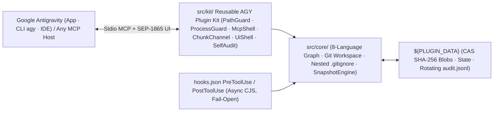

# DiffAtlas — Visual Diff Impact Graph & Agent Time Machine Plugin for Google Antigravity (`agy`)

**Language / 语言**: **English** | [简体中文](./README.zh-CN.md)


**Built Natively for the Google Antigravity (`agy`) Ecosystem · Native MCP App + Lifecycle Hooks + Skill + Rules · Compatible with Any MCP Client**

> **DiffAtlas** is a cross-platform, zero-native-dependency **Google Antigravity (`agy`) plugin** and open-source **MCP App (`SEP-1865`)** engineering cockpit. It extends **Antigravity 2.0**, **Antigravity CLI (`agy`)**, and **Antigravity IDE** with a visual Git diff reviewer, a deterministic multi-language file-level dependency blast-radius graph (**TS/JS, Vue/Svelte/Astro, Python, Go, Rust, C/C++, Java/Kotlin, C#**), a workspace file tree with native `fileView` jump, and a millisecond `PreToolUse` / `PostToolUse` **Agent Time Machine** — while shipping a reusable, domain-agnostic **`src/kit/` Antigravity Plugin Kit** to accelerate community ecosystem extensions.
>
> **Scope & Boundaries**: Want to know exactly what DiffAtlas excels at — and its current boundaries (e.g., file-level vs compiler/LSP granularity, hook-only Time Machine scope, and large-monorepo caps)? Read **Scope, Strengths & Limitations** ([English](./docs/SCOPE_AND_LIMITATIONS.md) / [中文](./docs/SCOPE_AND_LIMITATIONS.zh-CN.md)) before adopting.
>
> **Platform Testing Disclaimer (Important)**: Apart from **Windows** (physically tested by the author), non-Windows operating systems (macOS, Linux, etc.) have **not been manually tested on real hardware** and rely solely on AI Agent-driven cross-platform code adaptations and automated tests. **Full compatibility on non-Windows hosts cannot be guaranteed — non-Windows users should download with caution.** Read **Platform Testing Status & Compatibility Disclaimer** ([English](./docs/PLATFORM_TESTING_DISCLAIMER.md) / [中文](./docs/PLATFORM_TESTING_DISCLAIMER.zh-CN.md)).

---

## Real-World Use Cases: What Can You Use DiffAtlas For?

In plain terms, **DiffAtlas** is a **blast-radius review cockpit and instant safety net for AI-assisted coding**, plus a reusable foundation for building new **Google Antigravity (`agy`)** plugins:

| Everyday Workflow | The Real Problem | How DiffAtlas Solves It |
| :--- | :--- | :--- |
| **1. Post-Edit AI Change Review (Prevent Silent Breakage)** | An AI turn touches 5–20 files at once; reading linear red/green diffs alone makes it easy to miss untouched downstream modules and tests that quietly break | Renders a deterministic **Changed (Hop 0) → 1-Hop Direct → 2-Hop Indirect → Recommended Tests** graph with exact `file:line` evidence across 8 mainstream language families — offline and without language compilers |
| **2. Pre-Refactor "What-If" Simulation & Context Injection** | Before asking an agent to refactor a shared utility, type, or core service, you want to know what depends on it so the agent does not break callers | Click **Simulate Impact** *before* editing to inspect downstream callers, then click **Attach Blast Radius + Tests** to inject those files straight into your next conversation turn via `updateModelContext()` |
| **3. Millisecond Safety Net Between Git Commits** | An exploratory AI turn goes sideways before you ran `git commit`, and you also edited a file by hand — running `git checkout` risks wiping your manual work | Captures automatic sub-50ms pre-edit snapshots; roll back a **single file or an entire Agent turn** safely. Rollback is **human-exclusive** (invisible to LLMs), blocks overwrites on manual edits, and saves an Undo-of-Undo backup first |
| **4. Starter Kit for Building New Antigravity (`agy`) Plugins** | Building a custom `agy` MCP App (e.g., 3D viewer, DB explorer, trace inspector) requires boilerplate for sandboxing, chunked streaming, theme sync, and cleanroom audits | Reuse the domain-agnostic [`src/kit/`](./docs/ARCHITECTURE_AND_ECOSYSTEM.md) plugin foundation and automated 14-check cleanroom verifier out of the box |

> **Clear Boundaries**: DiffAtlas **complements — and does NOT replace — Git** (branching, history, and reverting shell `run_command` edits stay in Git) or **IDE compilers / LSPs** (compiler-exact type errors and symbol renames). See **Scope, Strengths & Limitations** ([English](./docs/SCOPE_AND_LIMITATIONS.md) / [中文](./docs/SCOPE_AND_LIMITATIONS.zh-CN.md)) for full details.

---

## Why DiffAtlas for the Google Antigravity (`agy`) Ecosystem?

AI-first coding in **Google Antigravity (`agy`)** moves fast — agents can touch 5–20 files in a single turn. Reviewing only raw text diffs misses downstream breakage, affected tests, and safe single-file rollback.

DiffAtlas extends **Google Antigravity** cleanly through **100% official public extension contracts** (zero monkey-patching, zero host DOM intrusion, zero private APIs):

| Antigravity (`agy`) Ecosystem Pillar | How DiffAtlas Extends It | Standard / Contract |
| :--- | :--- | :--- |
| **1. Native MCP App UI (`ui://`)** | Always-available visual workbench in Antigravity 2.0's right-hand **`aux_pane`** and left-hand **`global`** sidebar, with native **`fileView`** jump, **`updateModelContext()`** context pills, resizable split diff preview, live light/dark theme sync, and an isolated plugin-only `EN / 中文` toggle | `@modelcontextprotocol/ext-apps` (SEP-1865) + `com.google.antigravity/ui` |
| **2. Lifecycle Hooks (`hooks.json`)** | Sub-50ms fail-open **`PreToolUse`** + **`PostToolUse`** content-addressed SHA-256 single-file snapshots stored in `${PLUGIN_DATA}`, powering 3-way conflict-checked human rollback | Antigravity `hooks.json` (`PLUGIN_ROOT` / `PLUGIN_DATA`) |
| **3. Agent Skill (`skills/diffatlas/SKILL.md`)** | Progressive-disclosure `/diffatlas` workflow teaching the agent when to open the visual cockpit, evaluate blast radius before refactoring, and inspect checkpoints | Antigravity Skills Spec |
| **4. Always-On Safety Rules (`rules/AGENTS.md`)** | Enforces exact `file:line` import evidence citations, honest high/low confidence labeling, and human-exclusive rollback governance | Antigravity Rules Spec (`rules/AGENTS.md`) |
| **5. Reusable `src/kit/` Plugin Kit** | Domain-agnostic TypeScript foundation (`PathGuard`, `ProcessGuard`, `PluginStateStore`, `ChunkChannel`, `McpPluginShell`, `UiShell`, `SelfAudit`) ready to fork for new **Antigravity (`agy`)** MCP App plugins (3D/CAD viewers, DB explorers, trace viewers, design previewers) | Zero-native-addon TypeScript + Vite single-file CSP bundle |

---

## Key Capabilities

### 1. Deterministic 1–2 Hop Multi-Language Blast Radius Graph (8 Mainstream Language Families)
- **Zero Native C++ Compilation (`node-gyp`-free)**: Pure TypeScript/JS + WASM parsers covering **TypeScript / JavaScript**, **Vue / Svelte / Astro SFCs**, **Python**, **Go**, **Rust**, **C / C++**, **Java / Kotlin**, and **C#** — installing identically on Windows, macOS (Apple Silicon & Intel), and Linux without language compilers, Docker, or `node-gyp`.
- **Real-World Project Fidelity**: Honors root & nested `.gitignore` + `.git/info/exclude`, `tsconfig.json` / `jsconfig.json` JSONC `extends` + multi-`references` + `paths` / `baseUrl`, Vue 3.3+ `<script setup generic="...">` & Astro frontmatter, `go.mod` + `replace` + same-package `_test.go`, Cargo workspaces (`Cargo.toml` crate names, `mod`, `use crate::/super::`, lifetimes), C/C++ `#include "..."` & workspace `include/` headers, JVM packages/same-package siblings/wildcard imports, and C# type-filtered namespace `using`.
- **Interactive Layered SVG Graph + What-If Simulation**: Visualizes **Upstream Deps → Changed (Hop 0) → Direct Impact (1-hop) → Indirect Impact (2-hop)** plus **Recommended Test Files**. Click **Simulate Impact** on any supported code file to preview its blast radius *before* editing.
- **Evidence-First & Honest Confidence**: Every edge cites exact `file:line` and sanitized source snippets. Dynamic loaders (`import(expr)`, `require(expr)`, `importlib.import_module`, `plugin.Open`, `dlopen`, `Class.forName`, `Assembly.Load`) and wildcard/ambiguous package imports are explicitly tagged **Low Confidence** so neither the reviewer nor the agent gets false certainty.
- **Dual-Surface CLI & Headless Support**: In **Antigravity CLI (`agy`)** or non-UI MCP clients, `analyze_diff_impact` degrades seamlessly into concise, PR-ready, prompt-injection-sanitized Markdown evidence tables.

### 2. Deep Native Antigravity (`agy`) Workbench Integration
- **One-Click Native `fileView` with Graceful `-32601` Fallback**: Clicking any file or graph node invokes `com.google.antigravity/toggle-aux-pane` (`tabType: "fileView"`) in Antigravity's side pane. On `global` sidebar views or third-party MCP hosts (`-32601`), DiffAtlas automatically opens a **resizable split-pane inline diff / chunked read-only preview** (Pointer Capture drag handle + keyboard arrows + persisted split ratio).
- **One-Click Context Pill Attachment**: Select files or the entire blast radius + recommended tests and attach them directly to your next conversation turn via `app.updateModelContext()` (with one-click Clear Pill).
- **Adaptive Surface Capability Gating**: Automatically detects `app.getHostCapabilities()` so conversation-only controls hide cleanly in `global` sidebar views.
- **Live Theme Sync + Isolated Bilingual Toggle**: Syncs real-time host theme tokens via `applyHostStyleVariables` (`system` / `dark` / `light`) and offers an independent **`EN / 中文`** UI switch scoped strictly inside the DiffAtlas sandbox iframe (zero conflict with host or other localization plugins).

### 3. Millisecond Agent Time Machine (`PreToolUse` + `PostToolUse`)
- **Sub-50ms Content-Addressed Snapshots**: Automatically captures deduplicated SHA-256 pre-edit blobs before `write_file` / `edit_file` / `replace_file_content` edits, with async stdin streaming (immune to macOS/Linux `EAGAIN` pipe hangs) and an active 3.5s fail-open watchdog so hooks never stall the agent loop.
- **3-Way Human-Edit Conflict Detection**: Compares `currentDiskSha256` against `latestTrackedPostSha256` and `targetPreSha256` before restoring, blocking accidental overwrites of manual edits until explicitly confirmed.
- **Mandatory Undo-of-Undo Safety Backup**: Every rollback saves the current workspace disk state to a `pre_rollback_backup` checkpoint before touching a single byte (and preserves POSIX executable permissions like `0755` on macOS/Linux).
- **Human-Exclusive Rollback Boundary**: `app_preview_rollback` and `app_restore_checkpoint` declare `visibility: ["app"]`, making destructive restore capabilities completely invisible to LLMs.

---

## Architecture & Antigravity Ecosystem Blueprint



Want to build your own **Google Antigravity (`agy`) MCP App plugin**? Read **Architecture & Ecosystem Extension Guide** ([English](./docs/ARCHITECTURE_AND_ECOSYSTEM.md) / [中文](./docs/ARCHITECTURE_AND_ECOSYSTEM.zh-CN.md)) to see how `src/kit/` encapsulates security sandboxing, bounded chunk streaming (`<= 3` in-flight calls), `PLUGIN_DATA` state persistence, and zero-`node_modules` cleanroom auditing for reuse in companion plugins.

---

## Surface & Cross-Platform Compatibility

| Surface / Host | Visual Workbench UI (`aux_pane` / `global`) | Native `fileView` & Context Pill | Time Machine Hooks (`hooks.json`) | CLI / Markdown Fallback |
| :--- | :---: | :---: | :---: | :---: |
| **Google Antigravity App (2.0)** | Full (`aux_pane` + `global`) | Full (`fileView` + `updateModelContext`) | Full (`PreToolUse` + `PostToolUse`) | Full |
| **Google Antigravity CLI (`agy`)** | N/A (terminal) | N/A | Full (`PreToolUse` + `PostToolUse`) | Full (`analyze_diff_impact`, `list_checkpoints`) |
| **Google Antigravity IDE / Extensions** | Surface-dependent | Surface-dependent | Full | Full |
| **Other MCP Apps Hosts (SEP-1865)** | Full (inline UI + theme sync) | Auto-fallback (`-32601` inline preview) | Host-dependent | Full |
| **Standard Stdio MCP Clients** | N/A | N/A | Host-dependent | Full Markdown reports |

**Operating Systems**: Requires **Node.js `>= 20 LTS`** (`20.x`, `22.x`, `24.x`; **Git** optional). Physically tested by the author on **Windows 10/11**; adaptations for **macOS** and **Linux / WSL** were built and verified via **AI Agent automated tests only** without hands-on physical host testing, so full compatibility on non-Windows systems cannot be guaranteed — non-Windows hosts should download with caution (see **Platform Testing Status & Compatibility Disclaimer** ([English](./docs/PLATFORM_TESTING_DISCLAIMER.md) / [中文](./docs/PLATFORM_TESTING_DISCLAIMER.zh-CN.md))).

---

## Quick Start (Zero Native Compilation, Zero Build Step Required)

**Prerequisite**: Only **Node.js >= 20 LTS** (`node -v`). No Python, Docker, Rust, or C++ compiler (`node-gyp`) required.

### Option A: One-Command Install via Antigravity CLI (`agy`) — Recommended
Because prebuilt pure-JS/HTML runtime bundles (`dist/server/index.mjs`, `dist/hooks/lifecycle-hook.cjs`, `dist/ui/app.html`) ship cleanly with zero `node_modules` needed at runtime, installing from GitHub works immediately across Windows, macOS, and Linux:

```bash
# Install globally into Antigravity (~/.gemini/config/plugins/diffatlas/)
agy plugin install https://github.com/JiuYue-sky/DiffAtlas

# Verify installation & components
agy plugin list
```

> **Tip (Global vs Workspace Install)**: Installing globally into `~/.gemini/config/plugins/diffatlas/` makes DiffAtlas available across **every** workspace and in Antigravity's left-hand `global` sidebar without copying files into each project. See **Installation & Compatibility Guide** ([English](./docs/INSTALLATION_AND_COMPATIBILITY.md) / [中文](./docs/INSTALLATION_AND_COMPATIBILITY.zh-CN.md)) for manual zip/tar.gz install and workspace-scoped `.agents/plugins/` details.

### Option B: Manual Global Install from GitHub Releases
1. Download `diffatlas-plugin-v<version>.zip` (Windows) or `diffatlas-plugin-v<version>.tar.gz` (macOS/Linux) from [GitHub Releases](https://github.com/JiuYue-sky/DiffAtlas/releases) and verify its `.sha256` checksum.
2. Extract the `diffatlas/` directory directly into your Antigravity global plugins directory:
   - **Windows**: `%USERPROFILE%\.gemini\config\plugins\diffatlas\`
   - **macOS / Linux**: `~/.gemini/config/plugins/diffatlas/`
3. Open Antigravity → **Customizations > Installed** (no restart required for new plugins) or open **DiffAtlas** from the right-hand side pane `+` menu or left sidebar.

### Option C: Build & Run Full Cleanroom Verification from Source
```bash
git clone https://github.com/JiuYue-sky/DiffAtlas.git
cd DiffAtlas
npm install
npm run verify
```

`npm run verify` executes all 4 engineering gates:
1. Strict TypeScript check (`tsc --noEmit`)
2. Single-file CSP-clean UI build (`dist/ui/app.html`) + zero-dependency ESM server & fast-boot CJS hook bundling + local `.agents/plugins/diffatlas/` dev staging
3. Full Vitest suite (OWASP `PathGuard` security, 3-way Time Machine state machine, cross-OS parsers, `es-module-lexer` oracle, and 1,000-file benchmark)
4. Built-in `self-audit` + isolated OS temp **zero-`node_modules` cleanroom** Stdio MCP handshake, hook latency benchmark, license allowlist, link integrity, and secret/path leak scan (`dist/build_verification.json`)

---

## Registered MCP Tools & Visibility Boundaries

| Tool Name | Visibility | Entrypoints | Purpose |
| :--- | :---: | :---: | :--- |
| `open_workbench` | `model`, `app` | `aux_pane`, `global` | Launches or refreshes the interactive DiffAtlas MCP App workbench (accepts `{}`) |
| `analyze_diff_impact` | `model`, `app` | Inline / CLI | Computes 1–2 hop multi-language blast radius with `file:line` evidence & recommended tests |
| `list_checkpoints` | `model`, `app` | Inline / CLI | Lists local `PreToolUse` checkpoints stored in `${PLUGIN_DATA}` |
| `app_get_workbench_state` | **`app` only** | UI internal | Hydrates full workspace tree, graph, checkpoints, and preferences |
| `app_analyze_impact` | **`app` only** | UI internal | Interactive What-If single-file blast-radius simulation |
| `app_get_file_diff` | **`app` only** | UI internal | `PathGuard`-protected unified diff or binary-safe read-only source preview |
| `app_read_chunk` | **`app` only** | UI internal | Bounded byte-slice file streamer (`utf8` / `base64`, `<= 3` concurrent calls) |
| `app_get_recent_targets` | **`app` only** | UI internal | Loads persisted recent workspaces & UI preferences from `${PLUGIN_DATA}` |
| `app_save_preferences` | **`app` only** | UI internal | Persists isolated UI language, theme override, active tab, and split ratio |
| `app_preview_rollback` | **`app` only** | UI internal | Runs 3-way disk/agent/baseline conflict check (full turn or single file) |
| `app_restore_checkpoint` | **`app` only** | UI internal | **Human-exclusive** rollback with mandatory `pre_rollback_backup` (invisible to LLMs) |

---

## Project Directory Structure

```text
DiffAtlas/
├── .github/
│   ├── ISSUE_TEMPLATE/              # Bug report & ecosystem feature request templates
│   ├── PULL_REQUEST_TEMPLATE.md     # Contributor PR verification checklist
│   └── workflows/                   # 3-OS Cleanroom CI & Tag Release Packager workflows
├── assets/logo.svg                  # High-contrast dual-theme 1:1 Antigravity plugin icon
├── dist/                            # Prebuilt pure-JS/HTML runtime bundles (zero node_modules!)
│   ├── hooks/lifecycle-hook.cjs     # Async fail-open PreToolUse / PostToolUse CJS bundle
│   ├── server/index.mjs             # Bundled Stdio MCP App server (ESM)
│   └── ui/app.html                  # Self-contained CSP-clean single-file React + SVG UI
├── docs/
│   ├── PLATFORM_TESTING_DISCLAIMER.md (.zh-CN.md)      # Non-Windows untested host caution & disclaimer (EN / 中文)
│   ├── SCOPE_AND_LIMITATIONS.md (.zh-CN.md)            # Scope, core strengths, limitations & roadmap (EN / 中文)
│   ├── ARCHITECTURE_AND_ECOSYSTEM.md (.zh-CN.md)       # AGY 5-pillar architecture & reusable src/kit guide (EN / 中文)
│   ├── INSTALLATION_AND_COMPATIBILITY.md (.zh-CN.md)   # Win/Mac/Linux & AGY App/CLI/IDE setup & troubleshooting (EN / 中文)
│   ├── RELEASE_AND_UPDATING_GUIDE.md (.zh-CN.md)       # User update guide, SemVer release & Marketplace playbook (EN / 中文)
│   └── THIRD_PARTY_NOTICES.md (.zh-CN.md)              # Dependency licenses & upstream standards registry (EN / 中文)
├── rules/AGENTS.md                  # Always-on Antigravity safety & evidence citation rules
├── scripts/
│   ├── build.mjs                    # Vite single-file + esbuild server/hook + local dev staging
│   ├── self-audit.mjs               # Cleanroom self-audit & manifest verifier CLI
│   └── package-release.mjs          # Cross-platform standalone .zip / .tar.gz + SHA-256 packager
├── skills/diffatlas/SKILL.md        # Progressive-disclosure /diffatlas Agent Skill
├── src/
│   ├── kit/                         # Reusable domain-agnostic Antigravity MCP App Plugin Kit
│   ├── core/                        # 8-language parsers, git workspace, gitignore, SnapshotEngine
│   ├── hooks/                       # Lifecycle hook entrypoint
│   ├── server/                      # DiffAtlas MCP server wiring
│   ├── shared/                      # Plugin identity & version constant
│   └── ui/                          # React workbench UI, inline SVG graph, file tree, EN/中文 i18n
├── tests/                           # Security, parser oracle, 1,000-file SLA & state-machine tests
├── CHANGELOG.md                     # Bilingual SemVer release changelog
├── CONTRIBUTING.md                  # Contribution guidelines & local verification gate
├── LICENSE                          # Canonical MIT License
├── NOTICE.md                        # License scope & non-affiliation notice
├── SECURITY.md                      # OWASP MCP threat model & private disclosure policy
├── hooks.json                       # Antigravity root lifecycle hooks manifest
├── mcp_config.json                  # Portable ${PLUGIN_ROOT} / ${PLUGIN_DATA} MCP server manifest
├── package.json                     # Project scripts, engines & AGY ecosystem keywords
└── plugin.json                      # Official Antigravity v1 plugin manifest ($schema validated)
```

---

## Documentation & Resources

- **Platform Testing Status & Compatibility Disclaimer (Must-Read for Non-Windows Hosts)**: [English](./docs/PLATFORM_TESTING_DISCLAIMER.md) / [中文](./docs/PLATFORM_TESTING_DISCLAIMER.zh-CN.md)
- **Scope, Core Strengths & Current Limitations**: [English](./docs/SCOPE_AND_LIMITATIONS.md) / [中文](./docs/SCOPE_AND_LIMITATIONS.zh-CN.md)
- **Architecture & Antigravity Ecosystem Kit (`src/kit/`)**: [English](./docs/ARCHITECTURE_AND_ECOSYSTEM.md) / [中文](./docs/ARCHITECTURE_AND_ECOSYSTEM.zh-CN.md)
- **Cross-Platform Installation & Troubleshooting (Win/Mac/Linux)**: [English](./docs/INSTALLATION_AND_COMPATIBILITY.md) / [中文](./docs/INSTALLATION_AND_COMPATIBILITY.zh-CN.md)
- **Updating, Release Automation & Marketplace Guide**: [English](./docs/RELEASE_AND_UPDATING_GUIDE.md) / [中文](./docs/RELEASE_AND_UPDATING_GUIDE.zh-CN.md)
- **Third-Party Open-Source Notices**: [English](./docs/THIRD_PARTY_NOTICES.md) / [中文](./docs/THIRD_PARTY_NOTICES.zh-CN.md)
- **Security Policy & Threat Model**: [SECURITY.md](./SECURITY.md) | **Contributing**: [CONTRIBUTING.md](./CONTRIBUTING.md) | **Notice**: [NOTICE.md](./NOTICE.md) | **Changelog**: [CHANGELOG.md](./CHANGELOG.md)

---

## Privacy, Security & Support

- **100% Local & Offline, Zero Telemetry**: Zero external network requests, zero CDN assets (strictly compatible with `default-src 'none'` CSP), and zero browser storage (`localStorage` / `IndexedDB` unused; state persists strictly inside `${PLUGIN_DATA}`).
- **OWASP MCP Defense-in-Depth**: Canonical `fs.realpathSync.native` workspace sandboxing, sensitive file denylists (`.git/**`, `.env*`, `*.pem`, `*.key`, `.ssh/*`, cloud credentials), secret/path redaction, and prompt-injection sanitization. See [SECURITY.md](./SECURITY.md).
- **Feedback & Maintainer Contact**: Open an issue on [GitHub Issues](https://github.com/JiuYue-sky/DiffAtlas/issues) or email **`jiuyue200712@gmail.com`** for cross-platform compatibility reports, new language parser proposals, or Antigravity ecosystem collaborations.

## License

Released under the [MIT License](./LICENSE). See [NOTICE.md](./NOTICE.md) for trademark non-affiliation and third-party license details.
