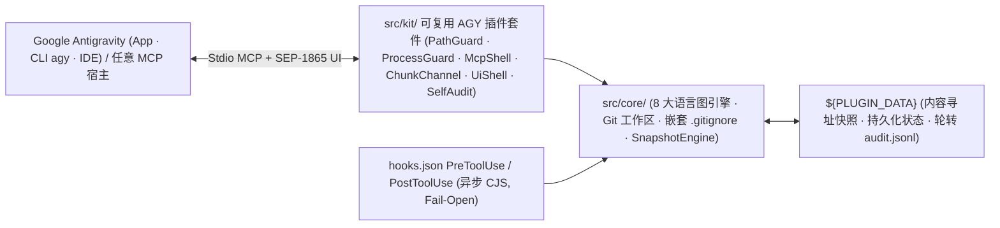

# DiffAtlas — 面向 Google Antigravity (`agy`) 生态的可视化变更影响图与 Agent 时光机插件

**语言 / Language**：**简体中文** | [English](./README.md)


**面向 Google Antigravity (`agy`) 生态原生构建 · 原生 MCP App + Lifecycle Hooks + Skill + Rules · 同时兼容任意标准 MCP 客户端**

> **DiffAtlas** 是一款跨平台（Windows / macOS / Linux）、零原生 C++ 编译依赖的 **Google Antigravity (`agy`) 原生插件** 与开源 **MCP App（`SEP-1865`）** 工程驾驶舱。它以 100% 官方公开扩展契约为 **Antigravity 2.0**、**Antigravity CLI (`agy`)** 与 **Antigravity IDE** 扩展了可视化 Git Diff 审查、确定性多语言文件级影响图谱（**TS/JS、Vue/Svelte/Astro、Python、Go、Rust、C/C++、Java/Kotlin、C#**）、原生 `fileView` 源码跳转与毫秒级 `PreToolUse` / `PostToolUse` **Agent 时光机**，同时沉淀出一套与领域解耦的可复用 **`src/kit/` Antigravity 插件基础套件**，助力社区开发者快速扩展 `agy` 生态。
>
> **适用边界速览**：想先了解本项目的最佳适用场景、核心强项以及当前版本（`v0.1.0`）的工程边界（如文件级 vs 编译器/LSP 粒度、时光机仅拦截文件编辑工具钩子、超大 Monorepo 建议按子包打开等），请直接查阅 **适用范围、核心强项与当前不足**（[中文](./docs/SCOPE_AND_LIMITATIONS.zh-CN.md) / [English](./docs/SCOPE_AND_LIMITATIONS.md)）。
>
> **跨系统实机测试声明（重要）**：除 **Windows** 系统经过作者实际运行测试外，其他操作系统（macOS / Linux 等）目前仅基于 AI Agent 进行了跨平台代码适配与自动化测试，**并未进行实机人工测试，无法保证其他系统是否真正完全适配，非 Windows 宿主机请谨慎下载**。详情请阅读 **跨平台实机测试状态与兼容性免责声明**（[中文](./docs/PLATFORM_TESTING_DISCLAIMER.zh-CN.md) / [English](./docs/PLATFORM_TESTING_DISCLAIMER.md)）。

---

## 典型应用场景：DiffAtlas 能拿来干嘛？

用一句大白话说，DiffAtlas 是给「用 AI 写代码的人」配的一套 **防翻车审查驾驶舱 + 秒级后悔药**，同时也是一套可复用的 Antigravity（`agy`）插件开发底座：

| 日常高频场景 | 你会遇到的真实痛点 | DiffAtlas 帮你怎么解决 |
| :--- | :--- | :--- |
| **1. AI 改完一堆文件后的防翻车审查** | Agent 一轮顺手改了 5～20 个文件，光翻红绿文本 Diff 很难看出「改了 A 会不会把没动过的 B 页面、C 服务或 D 测试搞挂」 | 侧边栏直接画出 **直接改动（Hop 0）→ 1 跳直接波及 → 2 跳间接波及 → 推荐先跑的测试文件**，每条线带精确 `文件:行号` 证据，覆盖 8 大主流语言且无需装编译器 |
| **2. 动手重构前的「What-If 预演」与精准喂上下文** | 想让 AI 动一个公共工具函数、基础类或老模块，心里没底怕牵一发动全身 | 改代码前先点 **「预演影响」** 看清下游波及面，再一键 **「挂入波及模块与测试」** 塞入下一轮对话上下文，让 AI 带着全局视野修改 |
| **3. 两次 Git Commit 之间的「秒级后悔药」** | AI 探索性修改走偏，但还没来得及 `git commit`，且中间你手工修过几个文件，直接 `git checkout` 怕冲掉自己的改动 | AI 编辑前自动毫秒级留底；改崩了可**按单文件或整轮回滚**。回滚权限**人类独占**（AI 看不到也调不了），自动拦截人工修改冲突，且回滚前必先备份当前现场（支持 Undo-of-Undo） |
| **4. 孵化新的 Antigravity (`agy`) 插件（生态脚手架）** | 想为 `agy` 生态开发 3D 查看器、数据库浏览器或日志面板，却要从零踩坑安全沙箱、分片传输与洁净室规范 | 直接复用领域解耦的 [`src/kit/`](./docs/ARCHITECTURE_AND_ECOSYSTEM.zh-CN.md) 通用插件基础套件与 14 项洁净室自检门禁 |

> **边界提示**：DiffAtlas **不替代 Git**（分支协作、版本历史与终端 `run_command` 修改回滚仍用 Git），也**不替代 IDE 编译器 / LSP**（精确类型检查与符号重命名仍靠编译器）；它专注补齐 **「AI 批量改代码 → 人类看清影响面 → 安全试错与单点回滚」** 这一高频痛点。完整边界详见 **适用范围、核心强项与当前不足**（[中文](./docs/SCOPE_AND_LIMITATIONS.zh-CN.md) / [English](./docs/SCOPE_AND_LIMITATIONS.md)）。

---

## 为什么为 Google Antigravity (`agy`) 生态打造 DiffAtlas？

在 **Google Antigravity (`agy`)** 等 AI-First 开发平台中，Agent 单轮对话就可能联动修改十余个文件。仅靠线性文本 Diff 很难一眼看清：*改了这里会影响哪些下游模块？该跑哪些测试？人工改过之后还能不能安全回滚某一个文件？*

DiffAtlas **严格基于 Antigravity 官方 5 大扩展支柱**完整打通工程审查闭环，零私有 API 依赖、零宿主 DOM 侵入：

| Antigravity (`agy`) 官方生态支柱 | DiffAtlas 的生态扩展实践 | 遵循标准与契约 |
| :--- | :--- | :--- |
| **1. 原生 MCP App 交互面板 (`ui://`)** | 在 Antigravity 2.0 右侧辅助面板（`aux_pane`）与左侧全局栏（`global`）提供实时可视化驾驶舱：原生 `fileView` 跳转、`updateModelContext()` 上下文胶囊、上下可拖动分屏预览、亮/暗主题同步、隔离式 `EN / 中文` 切换 | `@modelcontextprotocol/ext-apps` (SEP-1865) + `com.google.antigravity/ui` |
| **2. 生命周期钩子 (`hooks.json`)** | 毫秒级异步 `fail-open` 的 `PreToolUse` + `PostToolUse` 钩子，将内容寻址 SHA-256 单文件快照落盘至 `${PLUGIN_DATA}`，支撑三方人工冲突拦截回滚 | Antigravity `hooks.json` (`PLUGIN_ROOT` / `PLUGIN_DATA`) |
| **3. 渐进式 Agent Skill (`skills/diffatlas/SKILL.md`)** | 提供 `/diffatlas` 技能契约，按需引导 Agent 打开可视化工作台、改前/改后评估波及面并列出可回滚快照 | Antigravity Skills 规范 |
| **4. 常驻安全规范 (`rules/AGENTS.md`)** | 约束 Agent 汇报影响面时必须给出精确 `file:line` 源码证据、区分高低置信度，并严守回滚权限人类独占 | Antigravity Rules 规范 (`rules/AGENTS.md`) |
| **5. 可复用 `src/kit/` 生态基础套件** | 将路径安全沙箱、进程熔断、分片传输、`PLUGIN_DATA` 状态持久化、React 桥接与洁净室自检抽离为领域无关的 `src/kit/`，可直接复用于 3D 查看器、数据库浏览器、链路追踪面板等新一代 **`agy` 生态插件** | 零原生依赖 TypeScript + Vite 单文件 CSP 架构 |

---

## 核心特性

### 1. 确定性 1～2 跳多语言变更影响图谱（覆盖 8 大主流语言家族）
- **零原生 C++ 编译依赖（无 `node-gyp`）**：100% 纯 TypeScript/JS + WASM 静态解析器，覆盖 **TypeScript / JavaScript**、**Vue / Svelte / Astro 单文件组件**、**Python**、**Go**、**Rust**、**C / C++**、**Java / Kotlin** 与 **C#**；在 Windows、macOS（Apple Silicon / Intel）与 Linux 上无需各语言编译器、Docker 或 `node-gyp` 即可运行。
- **贴合真实工程结构**：支持根目录与嵌套 `.gitignore` + `.git/info/exclude`（自动跳过真实虚拟环境与 `target/debug`、`obj/Debug` 构建产物，安全保留 `src/env/`、`src/build/`、`src/target/` 源码目录）、`tsconfig.json` `extends` + 多 `references` + `paths`、Vue 3.3+ `<script setup generic="...">` 与 Astro frontmatter、`go.mod` + `replace` + 同包 `_test.go`、Cargo 工作区与 `mod`/`use crate::/super::`（免疫 Rust 生命周期 `'a`）、C/C++ 本地与 `include/` 头文件、JVM 包/同包引用/通配导入以及 C# 类型过滤式命名空间 `using`。
- **交互式内联 SVG 分层图 + 改前 What-If 预演**：清晰呈现 **上游被依赖 → 直接改动（Hop 0）→ 1 跳直接波及 → 2 跳间接波及 + 推荐关联测试文件**；可在文件树点击 **预演影响** 提前推演任意已支持代码文件的波及面。
- **强证据链 + 诚实置信度分层**：每条依赖边均附带精确 `file:line` 与脱敏源码片段；动态加载（`import(expr)`、`require(expr)`、`importlib.import_module`、`plugin.Open`、`dlopen`、`Class.forName`、`Assembly.Load`）及通配/模糊命名空间导入显式标注为 **Low Confidence（低置信度）**，绝不输出伪确定性结论。
- **双工作面优雅降级**：在 **Antigravity CLI (`agy`)** 或无 UI 的标准 MCP 客户端中，`analyze_diff_impact` 自动输出结构清晰、已做防提示词注入清洗的 Markdown 证据报告。

### 2. 原生 Antigravity (`agy`) 深度交互闭环
- **一键原生 `fileView` + `-32601` 优雅回退**：点击文件或图谱节点直接调用 `com.google.antigravity/toggle-aux-pane`（`tabType: "fileView"`）；在 `global` 全局视图或不支持该扩展的第三方宿主（`-32601`）中自动展开**底部上下可拖动调整占比的内联只读预览**（Pointer Capture 防脱手 + 键盘上下键微调 + 比例持久化）。
- **一键挂入上下文胶囊**：支持将勾选文件或完整波及面（Hop 0 + 1 跳受影响模块 + 推荐测试）通过 `app.updateModelContext()` 一键挂入下一轮对话输入胶囊，并支持一键清空。
- **动态能力门控**：实时读取 `app.getHostCapabilities()`，在无会话上下文的 `global` 全局侧栏中自动隐藏复选框与上下文胶囊按钮。
- **亮/暗主题同步 + 插件内独立双语切换**：实时响应宿主主题变量（`applyHostStyleVariables`），同时提供**严格隔离在插件沙箱内的 `EN / 中文` 切换按钮**，绝不干扰宿主界面或其他汉化插件。

### 3. 毫秒级 Agent 时光机（`PreToolUse` + `PostToolUse`）
- **低延迟内容寻址快照**：在 Agent 调用 `write_file` / `edit_file` / `replace_file_content` 前自动保存去重 SHA-256 备份；采用异步 `stdin` 流式读取（彻底规避 macOS/Linux 下 Go 宿主管道 `EAGAIN` 问题并确保 3.5 秒 `fail-open` 看门狗真实生效），永不卡死 Agent 主循环。
- **三方人工修改冲突拦截**：回滚前比对当前磁盘哈希、Agent 改后哈希与改前基线哈希；检测到人工修改时自动拦截并高亮差异，须由人类显式确认后才允许覆盖。
- **Undo-of-Undo 强制兜底备份**：每次执行回滚前必先将当前磁盘状态保存为 `pre_rollback_backup` 恢复点，且在 macOS/Linux 上保留脚本的可执行权限位（如 `0755`）。
- **回滚权限人类独占**：`app_preview_rollback` 与 `app_restore_checkpoint` 均声明 `visibility: ["app"]`，对大模型完全不可见。

---

## 架构总览与 `agy` 插件生态复用蓝图



希望基于这套架构开发新的 **Google Antigravity (`agy`) MCP App 插件**？请参阅 **架构设计与 `agy` 生态扩展指南**（[中文](./docs/ARCHITECTURE_AND_ECOSYSTEM.zh-CN.md) / [English](./docs/ARCHITECTURE_AND_ECOSYSTEM.md)），完整了解如何直接复用 `src/kit/` 的安全边界、并发分片传输与洁净室自检框架。

---

## 全载体与跨操作系统兼容矩阵

| 运行载体 / 宿主 | 可视化工作台 (`aux_pane` / `global`) | 原生 `fileView` 与上下文胶囊 | 时光机 Hooks (`hooks.json`) | CLI / Markdown 降级 |
| :--- | :---: | :---: | :---: | :---: |
| **Google Antigravity App (2.0)** | 完整支持（`aux_pane` + `global`） | 完整支持（`fileView` + `updateModelContext`） | 完整支持（`PreToolUse` + `PostToolUse`） | 完整支持 |
| **Google Antigravity CLI (`agy`)** | 终端无 iframe | 终端无侧栏 | 完整支持（`PreToolUse` + `PostToolUse`） | 完整支持（`analyze_diff_impact`、`list_checkpoints`） |
| **Google Antigravity IDE / 插件** | 按宿主工作面支持 | 按宿主能力门控 | 完整支持 | 完整支持 |
| **其他 MCP Apps (SEP-1865) 宿主** | 完整支持（内联面板 + 主题同步） | 自动优雅降级（`-32601` 内联预览） | 取决于宿主是否支持 Hooks | 完整支持 |
| **标准 Stdio MCP 客户端** | 无 UI | 无 UI | 取决于宿主 | 完整支持 Markdown 报告 |

**操作系统说明**：仅需 **Node.js `>= 20 LTS`**（Git 可选，非 Git 文件夹自动以零 Git 子进程开销提供依赖图与影响预演）。其中 **Windows 10/11** 已由作者完成实机运行验证；**macOS** 与 **Linux / WSL** 目前仅基于 AI Agent 完成代码级适配与自动化测试，尚未经作者实机测试，无法保证完全适配，非 Windows 宿主机请谨慎下载（详见 **跨平台实机测试状态与兼容性免责声明**（[中文](./docs/PLATFORM_TESTING_DISCLAIMER.zh-CN.md) / [English](./docs/PLATFORM_TESTING_DISCLAIMER.md)））。

---

## 快速开始（零原生编译、零构建门槛）

环境要求：仅需 **Node.js >= 20 LTS**（`node -v`），无需 Python、Docker 或 `node-gyp`。

### 方式一：通过 Antigravity CLI (`agy`) 一键直装（推荐）
仓库已随附零 `node_modules` 依赖的纯 JS/HTML 运行时产物（`dist/server/index.mjs`、`dist/hooks/lifecycle-hook.cjs`、`dist/ui/app.html`），三平台拉取即用：

```bash
# 全局安装到 Antigravity (~/.gemini/config/plugins/diffatlas/)
agy plugin install https://github.com/JiuYue-sky/DiffAtlas

# 查看已安装插件与组件状态
agy plugin list
```

> **提示（全局安装 vs 工作区安装）**：推荐全局安装到 `~/.gemini/config/plugins/diffatlas/`，可在**所有项目工作区**及 Antigravity 左侧 `global` 全局侧栏中随时唤起，无需在每个仓库重复拷贝。更多安装方式与跨系统排错详见 **安装配置与跨系统兼容指南**（[中文](./docs/INSTALLATION_AND_COMPATIBILITY.zh-CN.md) / [English](./docs/INSTALLATION_AND_COMPATIBILITY.md)）。

### 方式二：通过 GitHub Releases 独立压缩包离线安装
1. 前往 [GitHub Releases](https://github.com/JiuYue-sky/DiffAtlas/releases) 下载对应平台的 `diffatlas-plugin-v<版本>.zip`（Windows）或 `.tar.gz`（macOS / Linux）并校验 `.sha256`。
2. 将解压出的 `diffatlas/` 文件夹直接放入 Antigravity 全局插件目录：
   - **Windows**：`%USERPROFILE%\.gemini\config\plugins\diffatlas\`
   - **macOS / Linux**：`~/.gemini/config/plugins/diffatlas/`
3. 在 Antigravity 的 **Customizations > Installed** 中即可看到 `DiffAtlas` 自动就绪，随后可从右侧 `+` 菜单或左侧全局栏直接打开。

### 方式三：从源码构建并运行全量洁净室校验（开发者）
```bash
git clone https://github.com/JiuYue-sky/DiffAtlas.git
cd DiffAtlas
npm install
npm run verify
```

`npm run verify` 自动执行 4 道严格门禁：
1. 严格 TypeScript 类型检查（`tsc --noEmit`）
2. 零外链单文件 UI 打包（`dist/ui/app.html`）+ Stdio MCP Server / 异步 CJS Hook 打包 + 本地 `.agents/plugins/diffatlas/` 调试镜像同步
3. 全套 Vitest 单元测试（OWASP 安全越权、三方冲突回滚状态机、跨系统解析器回归、`es-module-lexer` 交叉校验与 1,000 文件性能压测）
4. 内置 `self-audit` + 操作系统临时目录**零 `node_modules` 洁净室**端到端 MCP 握手、Hook 延迟基准、许可证白名单、文档链接与零路径/密钥泄露扫描（生成 `dist/build_verification.json`）

---

## 目录结构说明

```text
DiffAtlas/
├── .github/
│   ├── ISSUE_TEMPLATE/              # Bug 反馈与生态扩展建议模板
│   ├── PULL_REQUEST_TEMPLATE.md     # PR 本地校验自查清单
│   └── workflows/                   # 三平台洁净室 CI 与 Tag 自动化发版打包工作流
├── assets/logo.svg                  # 高对比度双主题 1:1 Antigravity 插件图标
├── dist/                            # 零 node_modules 纯 JS/HTML 运行时产物（支持 agy 零编译直装）
├── docs/
│   ├── PLATFORM_TESTING_DISCLAIMER.zh-CN.md (.md)      # 非 Windows 系统未实机测试与谨慎下载声明（中文 / English）
│   ├── SCOPE_AND_LIMITATIONS.zh-CN.md (.md)            # 适用范围、核心强项、当前不足与演进路线（中文 / English）
│   ├── ARCHITECTURE_AND_ECOSYSTEM.zh-CN.md (.md)       # AGY 五支柱架构与可复用 src/kit 生态开发指南（中文 / English）
│   ├── INSTALLATION_AND_COMPATIBILITY.zh-CN.md (.md)   # Win/Mac/Linux 与 AGY App/CLI/IDE 安装排错指南（中文 / English）
│   ├── RELEASE_AND_UPDATING_GUIDE.zh-CN.md (.md)       # 用户升级方式、作者发版清单与 AGY 市场上架指引（中文 / English）
│   └── THIRD_PARTY_NOTICES.zh-CN.md (.md)              # 第三方开源组件许可证与协议标准登记（中文 / English）
├── rules/AGENTS.md                  # Antigravity 常驻安全与证据链规范
├── scripts/                         # 构建脚本（build.mjs）、洁净室自检（self-audit.mjs）、发版打包（package-release.mjs）
├── skills/diffatlas/SKILL.md        # 渐进式 /diffatlas Agent Skill 契约
├── src/                             # kit/ 生态基础套件、core/ 核心引擎、hooks/、server/、ui/
├── tests/                           # 安全、状态机、跨系统解析器与 1,000 文件回归测试套件
├── CHANGELOG.md                     # 中英双语语义化版本变更日志
├── CONTRIBUTING.md                  # 贡献与本地校验指南
├── LICENSE                          # 标准 MIT 开源许可证
├── NOTICE.md                        # 协议适用范围、商标非关联与第三方声明
├── SECURITY.md                      # OWASP MCP 安全边界与漏洞私密反馈渠道
├── hooks.json                       # Antigravity 根目录生命周期钩子清单
├── mcp_config.json                  # 跨平台 ${PLUGIN_ROOT} / ${PLUGIN_DATA} MCP 服务配置
├── package.json                     # npm 清单与 AGY 生态检索关键词
└── plugin.json                      # 遵循官方 v1 Schema 的 Antigravity 插件清单
```

---

## 完整文档索引与反馈渠道

- **跨平台实机测试状态与兼容性免责声明（非 Windows 宿主机必读）**（[中文](./docs/PLATFORM_TESTING_DISCLAIMER.zh-CN.md) / [English](./docs/PLATFORM_TESTING_DISCLAIMER.md)）
- **适用范围、核心强项与当前不足（选型必读）**（[中文](./docs/SCOPE_AND_LIMITATIONS.zh-CN.md) / [English](./docs/SCOPE_AND_LIMITATIONS.md)）
- **架构设计与 `agy` 生态扩展套件 (`src/kit/`)**（[中文](./docs/ARCHITECTURE_AND_ECOSYSTEM.zh-CN.md) / [English](./docs/ARCHITECTURE_AND_ECOSYSTEM.md)）
- **跨平台安装配置与兼容排错指南（Windows / macOS / Linux）**（[中文](./docs/INSTALLATION_AND_COMPATIBILITY.zh-CN.md) / [English](./docs/INSTALLATION_AND_COMPATIBILITY.md)）
- **宿主机升级方式、作者开源发版流程与 Antigravity 市场上架指引**（[中文](./docs/RELEASE_AND_UPDATING_GUIDE.zh-CN.md) / [English](./docs/RELEASE_AND_UPDATING_GUIDE.md)）
- **第三方开源组件与上游协议声明**（[中文](./docs/THIRD_PARTY_NOTICES.zh-CN.md) / [English](./docs/THIRD_PARTY_NOTICES.md)）
- **安全边界与威胁模型**：[SECURITY.md](./SECURITY.md) | **贡献指南**：[CONTRIBUTING.md](./CONTRIBUTING.md) | **合规与非关联声明**：[NOTICE.md](./NOTICE.md) | **变更日志**：[CHANGELOG.md](./CHANGELOG.md)
- **问题反馈与维护者联系邮箱**：欢迎通过 [GitHub Issues](https://github.com/JiuYue-sky/DiffAtlas/issues) 或发送邮件至 **`jiuyue200712@gmail.com`** 反馈跨系统兼容问题、新语言解析器适配或 Antigravity 生态扩展建议。

## 隐私合规与开源协议

- **100% 本地离线、零遥测**：零外部网络请求、零 CDN 外链（严格满足 `default-src 'none'` 默认 CSP）、不使用浏览器 `localStorage` / `IndexedDB`（所有持久化状态严格保存在 `${PLUGIN_DATA}`）。
- 本项目基于 **[MIT License](./LICENSE)** 开源；第三方依赖许可与非官方关联说明见 **[NOTICE.md](./NOTICE.md)**。
