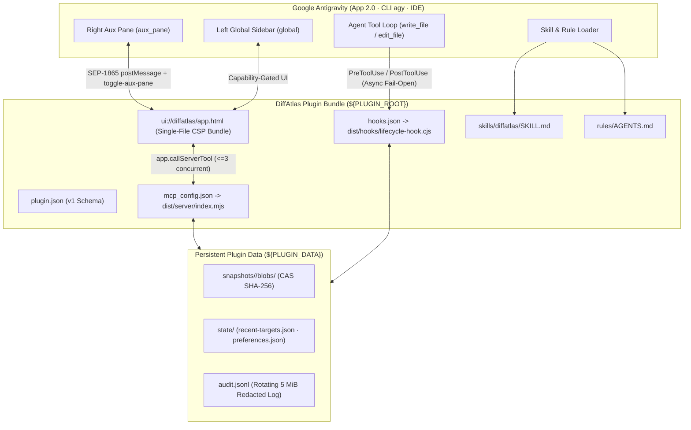

# Architecture & Google Antigravity (`agy`) Ecosystem Extension Guide

[简体中文](./ARCHITECTURE_AND_ECOSYSTEM.zh-CN.md) | **English**

DiffAtlas is built both as an end-user visual diff & rollback workbench and as an **open-source architectural reference for extending the Google Antigravity (`agy`) ecosystem** using 100% official, zero-native-dependency standards (`plugin.json`, `mcp_config.json`, `hooks.json`, `SKILL.md`, `rules/AGENTS.md`, and `@modelcontextprotocol/ext-apps` SEP-1865).

---

## 1. How DiffAtlas Extends All 5 Google Antigravity (`agy`) Customization Pillars

Most extensions ship only a standalone prompt skill or stateless CLI tool. DiffAtlas demonstrates how all **five official Antigravity plugin primitives** compose into a single install-once bundle:

### Pillar Breakdown
1. **MCP App UI (`ui://diffatlas/app.html`)**:
   - Served by `McpPluginShell` with MIME `text/html;profile=mcp-app` and `prefersBorder: false`.
   - Declares `com.google.antigravity/ui.entrypoints` for both `aux_pane` and `global` on `open_workbench` (accepts empty `{}` arguments cleanly).
   - Enforces `default-src 'none'` CSP: zero CDN `<script>`/`<link>`, zero `dangerouslySetInnerHTML`, zero `localStorage`/`IndexedDB`.
   - Respects Antigravity's trajectory cap (`< 768 KiB` combined `content` + `structuredContent` safety ceiling below the host's 1 MiB drop limit) and `<= 3` concurrent in-flight `callServerTool` scheduling (safely below the host's 4-call ceiling).
2. **Lifecycle Hooks (`hooks.json`)**:
   - Placed at the plugin root (`<plugin-root>/hooks.json`), runs cross-platform `node dist/hooks/lifecycle-hook.cjs` (relative to plugin root across `cmd /c` on Windows and `sh -c` on macOS/Linux), and enforces `timeout: 5` with an active 3.5s async fail-open watchdog.
   - Reads stdin asynchronously (`process.stdin`) so Go-host non-blocking pipes on macOS/Linux never throw `EAGAIN` and the watchdog timer stays live on the event loop.
3. **Progressive-Disclosure Skill (`skills/diffatlas/SKILL.md`)**:
   - Exposes `/diffatlas` on demand without bloating every conversation turn's context window.
4. **Always-On Rules (`rules/AGENTS.md`)**:
   - Enforces exact `file:line` citations, explicit High vs Low confidence separation, and human-exclusive rollback discipline whenever the plugin is enabled.
5. **Dual-Surface CLI Fallback**:
   - Every model-visible tool (`open_workbench`, `analyze_diff_impact`, `list_checkpoints`) returns both rich `structuredContent` for GUI frames and crisp, sanitized Markdown `content` for **Antigravity CLI (`agy`)** and non-UI MCP clients.

---

## 2. Reusable `src/kit/` — Building Your Own Antigravity (`agy`) MCP App Plugin

Everything inside `src/kit/` is **100% decoupled from Git, diffing, or code parsing** and can be reused directly to build companion Antigravity MCP App plugins (such as 3D/GLB asset inspectors, database schema explorers, trace workbenches, or design token previewers):

| Module in `src/kit/` | Responsibility | What It Solves Out of the Box |
| :--- | :--- | :--- |
| [`path-guard.ts`](../src/kit/path-guard.ts) | `PathGuard`, `toFileUri`, `fromFileUri`, `redactSecretsAndPaths`, `sanitizeUntrustedIdentifier` | OWASP MCP canonical `fs.realpathSync.native` sandboxing, symlink/NTFS Junction blocking, sensitive-file denylists, Windows reserved device guards, subresource SSRF validation, secret/PII redaction, and prompt-injection neutralization |
| [`process-guard.ts`](../src/kit/process-guard.ts) | `runCommandSafe`, `withTimeoutCircuitBreaker`, `installHookFailOpenWatchdog` | Injection-proof `shell: false` subprocesses, byte caps, cross-platform process-tree termination (`taskkill /T /F` vs `-pgid SIGKILL`), and deterministic async timeouts |
| [`runtime-paths.ts`](../src/kit/runtime-paths.ts) | `resolvePluginRuntimePaths`, `PluginStateStore`, `atomicWriteFileSync`, `appendAuditLogSync` | Portable `${PLUGIN_ROOT}` / `${PLUGIN_DATA}` resolution across global, workspace, and cleanroom runs; crash-safe atomic writes with Windows NTFS backoff & POSIX mode preservation; persistent UI preferences replacing `localStorage` |
| [`chunk-channel.ts`](../src/kit/chunk-channel.ts) & [`concurrency-queue.ts`](../src/kit/concurrency-queue.ts) | `readSafeFileChunk`, `BoundedConcurrencyQueue` | Bounded 256–512 KiB `utf8` & `base64` chunk streaming under `<= 3` concurrent in-flight calls (works for large text files and binary `.glb`/`.stl`/`.png` assets with zero UTF-8 boundary mojibake) |
| [`mcp-shell.ts`](../src/kit/mcp-shell.ts) | `McpPluginShell`, `enforceTrajectoryBudget`, `truncateUtf8Clean` | Standardized Stdio MCP server shell registering `ui://` single-file HTML (with hot-reload env override), Dual-Surface tools with `aux_pane`/`global` entrypoints, and strictly hidden `visibility: ["app"]` tools |
| [`ui-shell/host-bridge.ts`](../src/kit/ui-shell/host-bridge.ts) & [`usePluginShell.ts`](../src/kit/ui-shell/usePluginShell.ts) | `usePluginShell`, `AppServerClient`, `openNativeFileView`, `syncHostThemeAndStyles` | React hook wiring SEP-1865 events *before* `connect()`, real-time host theme variable synchronization, dynamic surface capability detection (`aux_pane` vs `global`), and graceful `-32601` `fileView` degradation |
| [`self-audit/auditor.ts`](../src/kit/self-audit/auditor.ts) | `runPluginSelfAudit` | Reusable 14-check automated quality gate: `plugin.json` v1 schema validation, zero native addons check, transitive license allowlist, CSP/XSS scan, zero-`node_modules` OS temp cleanroom MCP handshake, hook latency benchmark, broken doc link check, secret/path leak scan, and optional `agy plugin validate --strict` |

### Minimal Blueprint to Create a Companion Antigravity Plugin Using `src/kit/`

1. Copy `src/kit/`, `scripts/build.mjs`, `scripts/self-audit.mjs`, `scripts/package-release.mjs`, and `vite.config.ts`.
2. Define your `PluginIdentity` (`id`, `displayName`, `version`, `resourceUri: 'ui://<id>/app.html'`, `appHtmlEnvVar`).
3. Instantiate `new McpPluginShell(YOUR_IDENTITY)`, register your primary UI tool with `entrypoints: [{ type: 'aux_pane', title: '...' }, { type: 'global', title: '...' }]`, and register sensitive mutations with `registerAppOnlyTool()` (`visibility: ['app']`).
4. Build your React UI with `usePluginShell()` and `vite-plugin-singlefile`.
5. Run `npm run verify` to execute the zero-`node_modules` cleanroom handshake and compliance audit automatically.

---

## 3. Core Engine Design (`src/core/`)

### Polyglot Dependency Impact Graph Engine (`src/core/*-import-parser.ts`, `impact-analyzer.ts`)
- **8 Mainstream Language Families, Zero Native Addons**: Dedicated pure-TypeScript parsers cover **TS/JS** (`ts-import-parser.ts`), **Vue/Svelte/Astro SFCs** (`sfc-import-parser.ts`), **Python** (`py-import-parser.ts`), **Go** (`go-import-parser.ts`), **Rust** (`rust-import-parser.ts`), **C/C++** (`cpp-import-parser.ts`), **Java/Kotlin** (`jvm-import-parser.ts`), and **C#** (`csharp-import-parser.ts`), sharing an isomorphic language taxonomy in [`src/shared/languages.ts`](../src/shared/languages.ts) so the Vite browser UI stays 100% free of `node:*` imports.
- **Zero-False-Positive Masking**: Every parser strips UTF-8 BOMs and masks language-specific comments, nested block comments (Rust/Kotlin), raw/verbatim/text-block strings, regex literals, and HTML comments (preserving exact UTF-16 offsets and 1-based line numbers) before extracting import edges.
- **Lazy Workspace Indexing & Topology-Aware Incremental Cache**: Go (`go.mod` + `replace`), Rust (`Cargo.toml`), C/C++ (`include/` roots), JVM (`package` + top-level types/Kotlin functions), and C# (`namespace` + declared types) indexes are constructed lazily **only when files of that language exist** (zero overhead on TS/JS+Python repos). Per-file parse results are cached on `(mtimeMs, size, topologyHash)` covering the file set, `tsconfig.json`, `go.mod`, `Cargo.toml`, and JVM/C# declaration fingerprints so structural edits automatically invalidate stale edges.
- **Honest Confidence**: Static relative/module/header imports, barrel re-exports, `tsconfig.json` aliases, `go.mod` packages, Rust `mod`/`use`, and type-matched JVM/C# references are marked `high`. Dynamic loaders (`import(expr)`, `require(expr)`, `importlib`, `plugin.Open`, `dlopen`/`LoadLibrary`, `Class.forName`, `Assembly.Load`/`Type.GetType`), JVM wildcard `.*` imports, and unmatched C# multi-file namespace `using` directives are explicitly marked `low`.

### Agent Time Machine State Machine (`snapshot-engine.ts`)
- **Pre-State Preservation**: Within a single agent turn (`conversationId + modelName + promptHash`, split automatically on mid-turn model switches, `stepIdx` regression, or >30s idle gap), multiple edits to the same file preserve the **first** pre-edit SHA-256 blob while updating the **latest** `postSha256`.
- **3-Way Conflict Matrix**:
  - `NOOP_ALREADY_MATCHES`: Current disk already matches baseline.
  - `READY_CLEAN_RESTORE` / `READY_CLEAN_DELETE_CREATED`: Disk matches `latestTrackedPostSha256` — safe clean restore or deletion of agent-created file (plus canonical pruning of newly created empty parent directories).
  - `CONFLICT_HUMAN_MODIFIED`: Disk diverged from `latestTrackedPostSha256` (manual edit detected) — blocked until human explicitly checks override.
  - `pre_rollback_backup`: Written atomically *before* any disk mutation so every rollback itself is 100% reversible (Undo-of-Undo).

---

Back to [README (English)](../README.md) · [简体中文版架构文档](./ARCHITECTURE_AND_ECOSYSTEM.zh-CN.md)
