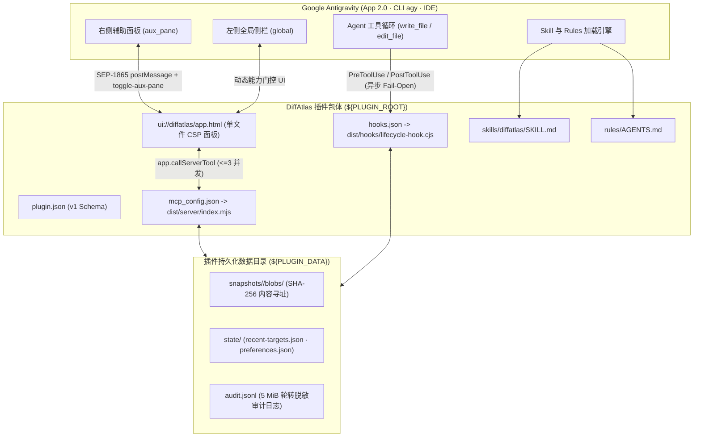

# 架构设计与 Google Antigravity (`agy`) 生态扩展开发指南

**简体中文** | [English](./ARCHITECTURE_AND_ECOSYSTEM.md)

DiffAtlas 既是一款面向开发者的可视化 Diff 影响图与时光机工作台，也是一份**基于 100% 官方公开标准扩展 Google Antigravity (`agy`) 生态的开源架构参考实现**（`plugin.json`、`mcp_config.json`、`hooks.json`、`SKILL.md`、`rules/AGENTS.md` 与 `@modelcontextprotocol/ext-apps` SEP-1865）。

---

## 1. DiffAtlas 如何完整打通 Google Antigravity (`agy`) 五大官方扩展支柱

大多数扩展仅封装单一提示词技能或无状态命令。DiffAtlas 演示了如何将 Antigravity 官方的全部 **5 类扩展原语** 组合成一个一键安装、生命周期统一的插件包：

### 五大支柱工程拆解
1. **原生 MCP App 交互面板 (`ui://diffatlas/app.html`)**：
   - 由 `McpPluginShell` 以 `text/html;profile=mcp-app` 与 `prefersBorder: false` 提供服务。
   - 在 `open_workbench` 工具上同时声明 `aux_pane` 与 `global` 官方入口（完美兼容 `{}` 空参冷启动）。
   - 严格遵循 `default-src 'none'` CSP：零外链 CDN、零 `dangerouslySetInnerHTML`、零 `localStorage`/`IndexedDB`。
   - 严格执行 `< 768 KiB` 轨迹总载荷预算（远低于宿主 1 MiB 截断红线）与 `<= 3` 并发请求调度（安全低于宿主 4 并发上限）。
2. **生命周期钩子 (`hooks.json`)**：
   - 严格置于插件根目录（`<plugin-root>/hooks.json`），采用跨平台 `node dist/hooks/lifecycle-hook.cjs`（相对插件根运行，兼容 Windows `cmd /c` 与 macOS/Linux `sh -c`），配置 `timeout: 5` 与内部 3.5 秒异步 `fail-open` 看门狗。
   - 采用异步 `process.stdin` 流式读取，规避 macOS/Linux 下 Go 语言服务器管道的 `EAGAIN` 问题并保证看门狗定时器真实生效。
3. **渐进式 Agent Skill (`skills/diffatlas/SKILL.md`)**：
   - 注册 `/diffatlas` 技能，按需加载完整操作流程，避免常驻挤占每轮上下文窗口。
4. **常驻安全规范 (`rules/AGENTS.md`)**：
   - 启用插件期间强制约束 Agent 引用精确 `file:line` 证据、区分高低置信度并严守人类独占回滚边界。
5. **双工作面 CLI 优雅降级**：
   - 所有模型可见工具（`open_workbench`、`analyze_diff_impact`、`list_checkpoints`）同时返回面板结构化数据与经防提示词注入清洗的 Markdown 报告，确保在 **Antigravity CLI (`agy`)** 与无 UI MCP 客户端中开箱可用。

---

## 2. 可复用 `src/kit/` —— 快速构建你的下一个 Antigravity (`agy`) MCP App 插件

`src/kit/` 中的全部代码与 Git、Diff 或代码解析 **100% 领域解耦**，社区开发者可以直接复用这套基础套件来构建 3D/GLB 资源查看器、数据库 Schema 浏览器、日志链路面板或设计系统预览器等新型 `agy` 插件：

| `src/kit/` 模块 | 核心导出 | 开箱即得的能力 |
| :--- | :--- | :--- |
| [`path-guard.ts`](../src/kit/path-guard.ts) | `PathGuard`、`toFileUri`、`fromFileUri`、`redactSecretsAndPaths`、`sanitizeUntrustedIdentifier` | OWASP MCP 规范化 `fs.realpathSync.native` 沙箱、防符号链接/NTFS Junction 逃逸、敏感文件黑名单、Windows 保留设备名拦截、子资源 SSRF 校验、密钥/路径脱敏与防间接提示词注入 |
| [`process-guard.ts`](../src/kit/process-guard.ts) | `runCommandSafe`、`withTimeoutCircuitBreaker`、`installHookFailOpenWatchdog` | 严禁 shell 注入（`shell: false`）、输出字节上限、跨平台进程树强杀（Windows `taskkill /T /F` 与 Unix `-pgid SIGKILL`）及确定性异步超时熔断 |
| [`runtime-paths.ts`](../src/kit/runtime-paths.ts) | `resolvePluginRuntimePaths`、`PluginStateStore`、`atomicWriteFileSync`、`appendAuditLogSync` | 统一解析全局、工作区与洁净室下的 `${PLUGIN_ROOT}` / `${PLUGIN_DATA}`；带 Windows NTFS 退避重试与 POSIX 权限位保留的原子落盘；替代 `localStorage` 的服务端状态存储 |
| [`chunk-channel.ts`](../src/kit/chunk-channel.ts) & [`concurrency-queue.ts`](../src/kit/concurrency-queue.ts) | `readSafeFileChunk`、`BoundedConcurrencyQueue` | `<= 3` 并发受控的 256–512 KiB `utf8` / `base64` 分片流式读取（大源码文件与二进制 `.glb`/`.stl`/`.png` 均零乱码传输） |
| [`mcp-shell.ts`](../src/kit/mcp-shell.ts) | `McpPluginShell`、`enforceTrajectoryBudget`、`truncateUtf8Clean` | 标准化 Stdio MCP 服务外壳：托管 `ui://` 单文件 HTML（含环境变量热重载）、注册 `aux_pane`/`global` 双工作面工具与严格隐藏的 `visibility: ["app"]` 工具 |
| [`ui-shell/host-bridge.ts`](../src/kit/ui-shell/host-bridge.ts) & [`usePluginShell.ts`](../src/kit/ui-shell/usePluginShell.ts) | `usePluginShell`、`AppServerClient`、`openNativeFileView`、`syncHostThemeAndStyles` | 在 `connect()` 前绑定 SEP-1865 事件、实时同步宿主主题变量、动态检测工作面能力并优雅处理 `-32601` 降级 |
| [`self-audit/auditor.ts`](../src/kit/self-audit/auditor.ts) | `runPluginSelfAudit` | 可复用 14 项自动质量门禁：`plugin.json` v1 Schema 校验、零原生编译检查、传递依赖许可证白名单、CSP/XSS 扫描、零 `node_modules` 洁净室 MCP 握手、Hook 延迟基准、文档断链扫描、密钥/个人路径防泄漏扫描及可选 `agy plugin validate --strict` |

### 基于 `src/kit/` 孵化新 Antigravity 插件的 5 步最小蓝图

1. 复用 `src/kit/`、`scripts/build.mjs`、`scripts/self-audit.mjs`、`scripts/package-release.mjs` 与 `vite.config.ts`。
2. 定义插件身份对象 `PluginIdentity`（`id`、`displayName`、`version`、`resourceUri: 'ui://<id>/app.html'`、`appHtmlEnvVar`）。
3. 实例化 `new McpPluginShell(YOUR_IDENTITY)`，注册带 `aux_pane` / `global` 入口的主面板工具，并将写/删类敏感操作注册为 `registerAppOnlyTool()`（`visibility: ['app']`）。
4. 使用 `usePluginShell()` 与 `vite-plugin-singlefile` 构建单文件 React UI。
5. 运行 `npm run verify`，一键跑通零 `node_modules` 洁净室握手与全量合规门禁。

---

## 3. 核心引擎设计（`src/core/`）

### 多语言依赖影响图引擎（`src/core/*-import-parser.ts`、`impact-analyzer.ts`）
- **8 大主流语言家族、零原生编译**：内置纯 TypeScript 解析器覆盖 **TS/JS**（`ts-import-parser.ts`）、**Vue/Svelte/Astro SFC**（`sfc-import-parser.ts`）、**Python**（`py-import-parser.ts`）、**Go**（`go-import-parser.ts`）、**Rust**（`rust-import-parser.ts`）、**C/C++**（`cpp-import-parser.ts`）、**Java/Kotlin**（`jvm-import-parser.ts`）与 **C#**（`csharp-import-parser.ts`），并通过同构模块 [`src/shared/languages.ts`](../src/shared/languages.ts) 共享语言分类，确保 Vite 前端单文件包体零 `node:*` 污染。
- **零误报词法屏蔽**：各解析器在提取导入语句前统一剥离 UTF-8 BOM 并屏蔽单/多行注释、嵌套块注释（Rust/Kotlin）、原始/逐字/多行文本块字符串、正则字面量及 HTML 注释（严格保持 UTF-16 偏移与精确 1-based 行号），杜绝注释与字符串引发的假阳性依赖边。
- **惰性工作区索引与拓扑感知增量缓存**：Go（`go.mod` + `replace`）、Rust（`Cargo.toml`）、C/C++（`include/` 根）、JVM（`package` 与顶层类型/Kotlin 函数）及 C#（`namespace` 与声明类型）索引**仅在工作区存在对应语言文件时才惰性构建**（对纯 TS/JS+Python 仓库零额外开销）。单文件解析结果按 `(mtimeMs, size, topologyHash)` 缓存，其中 `topologyHash` 覆盖文件集合、`tsconfig.json`、`go.mod`、`Cargo.toml` 及 JVM/C# 声明指纹，结构或配置变更时自动精准失效。
- **诚实置信度分层**：静态相对/模块/头文件导入、Barrel 重导出、`tsconfig.json` 别名、`go.mod` 包路径、Rust `mod`/`use` 及类型精确命中的 JVM/C# 引用标记为 `high`；动态加载（`import(expr)`、`require(expr)`、`importlib`、`plugin.Open`、`dlopen`/`LoadLibrary`、`Class.forName`、`Assembly.Load`/`Type.GetType`）、JVM `.*` 通配导入以及未精确命中类型的 C# 多文件命名空间 `using` 显式标为 `low`。

### Agent 时光机状态机（`snapshot-engine.ts`）
- **首态保留原则**：在同一轮 Agent 对话内（按 `conversationId + modelName + promptHash` 分组，遇中途切模型、`stepIdx` 回退或静默超 30 秒自动切分新恢复点），同一文件被连续修改多次时始终保留**首次改前**的 SHA-256 快照并持续更新**最新改后**哈希。
- **三方冲突判定矩阵**：
  - `NOOP_ALREADY_MATCHES`：当前磁盘与基线完全一致。
  - `READY_CLEAN_RESTORE` / `READY_CLEAN_DELETE_CREATED`：磁盘与 Agent 最新改后哈希一致，可安全恢复原文件或清理新建文件（并规范回收新生成的空父目录）。
  - `CONFLICT_HUMAN_MODIFIED`：磁盘内容偏离 Agent 改后哈希（检测到人工修改），强制拦截直到人类勾选确认覆盖。
  - `pre_rollback_backup`：任何磁盘写入/删除之前必先原子生成回滚前备份，保证每一次回滚本身也可逆（Undo-of-Undo）。

---

返回 [简体中文 README](../README.zh-CN.md) · [English Version](./ARCHITECTURE_AND_ECOSYSTEM.md)
